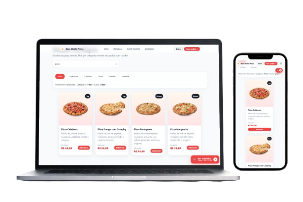

<div align="center">

<h1>🍕 Base Studio Pizzas</h1>

<strong>Plataforma full-stack de delivery para pizzarias</strong>

<p>Da escolha da pizza até a entrega: fluxos de cliente, administração e motoboy em uma única aplicação.</p>

<a href="https://github.com/HelioConde/site-pizzaria"></a>
<a href="https://react.dev/"></a>
<a href="https://supabase.com/"></a>

<p><a href="https://helioconde.github.io/site-pizzaria/"><strong>Ver demonstração</strong></a> · <a href="https://github.com/HelioConde/site-pizzaria"><strong>Código-fonte</strong></a> · <a href="https://github.com/HelioConde"><strong>Desenvolvedor</strong></a></p>

</div>



## Visão geral

O **Base Studio Pizzas** é um projeto de portfólio **finalizado em sua versão 1.0**. Seu objetivo foi construir uma experiência de delivery que envolvesse mais que uma vitrine: um fluxo de pedidos, interfaces por perfil, dados persistidos, atualização de status e ferramentas para acompanhar entregas.

A versão de portfólio está concluída. Isso **não significa que a aplicação já esteja homologada para uma operação comercial**: autenticação, permissões no banco, serviços de pagamento, geolocalização e conformidade precisam ser revisados para uso com clientes reais.

### O que foi desenvolvido

| Jornada | Recursos |
| --- | --- |
| **Cliente** | Cardápio, categorias, pesquisa, carrinho e checkout |
| **Conta** | Autenticação, perfil, endereços e histórico de pedidos |
| **Gestão** | Pedidos, produtos, categorias, clientes, entregadores, pagamentos e relatórios |
| **Entrega** | Visualização de pedidos, aceite, mudança de status e GPS com permissão |
| **Acompanhamento** | Estado do pedido, mapa, rota e atualizações via Supabase |
| **Pagamento online** | Interface e chamadas de checkout; ativação real requer backend seguro |

## Como a aplicação funciona

```text
           CLIENTE                 ADMINISTRAÇÃO             ENTREGADOR
   Cardápio → Carrinho
             │
          Checkout
             │
             └──► Pedido no Supabase
                          │
                   Pedido recebido
                          │
                     Em preparo
                          │
                    Entrega liberada ──────► Aceita entrega
                                               │
                                         Sai para entrega
                                               │
                          ◄──── Status + localização (com autorização)
                          │
                  Pedido entregue
```

A interface consulta o Supabase para dados operacionais e usa **Supabase Realtime** onde previsto para acompanhar atualizações. A rota de entrega pode utilizar uma Edge Function ligada ao *openrouteservice*.

### Telas e organização do projeto

| Área | Caminho |
| --- | --- |
| Home e navegação | `src/App.jsx` · `src/components/` |
| Catálogo e carrinho | `src/pages/Menu/` |
| Finalização | `src/pages/Checkout/` |
| Login e área do cliente | `src/pages/Auth/` · `src/pages/Account/` |
| Administração | `src/pages/Admin/` |
| Motoboy | `src/pages/Motoboy/` |
| Mapas | `src/components/maps/` |
| Pagamento/retorno | `src/pages/PaymentOnlineCheck/` · `src/pages/PaymentSuccess/` |
| Backend de rotas incluído | `supabase/functions/get-delivery-route/` |

## Tecnologias

**Frontend:** React 19, JavaScript, Vite, React Router, CSS Modules e Lucide.  
**Dados e autenticação:** Supabase, PostgreSQL, Supabase Auth e Realtime.  
**Mapas:** Leaflet, React Leaflet, OpenStreetMap, Geolocation API e openrouteservice.  
**Pagamentos:** integração Stripe via fluxo de checkout; requer função de backend configurada.  
**Qualidade:** ESLint e workflow de testes com Playwright no GitHub Actions.

## Executar no computador

**Requisitos:** Node.js compatível com o Vite do projeto (recomenda-se Node.js 22 atualizado), npm e acesso a um ambiente Supabase preparado.

```bash
git clone https://github.com/HelioConde/site-pizzaria.git
cd site-pizzaria
npm ci
```

Crie um arquivo **`.env.local`** na raiz:

```dotenv
VITE_SUPABASE_URL=https://SEU-PROJETO.supabase.co
VITE_SUPABASE_ANON_KEY=SUA_CHAVE_PUBLICA
```

Depois inicie:

```bash
npm run dev
```

Abra o endereço exibido no terminal (normalmente `http://localhost:5173`).

> **O que as variáveis não fazem sozinhas:** para usar login, catálogo, pedidos ou Realtime, o projeto Supabase precisa ter tabelas, dados e políticas RLS compatíveis. O repositório inclui a função de roteamento; outras integrações, como `create-checkout-session`, precisam estar implantadas e configuradas separadamente. A aplicação não deve receber chaves privadas no frontend.

## Qualidade e publicação

```bash
npm run lint
npm run build
npm run preview
```

- O workflow [Playwright Tests](.github/workflows/playwright.yml) define a execução de testes de navegador em push e pull request. Consulte [Actions](https://github.com/HelioConde/site-pizzaria/actions) para ver os resultados reais — **não há afirmação de que todos os testes estejam passando agora**.
- O build de produção usa o prefixo `/site-pizzaria/` configurado em `vite.config.js`.
- O comando `npm run deploy` utiliza `gh-pages` e exige autenticação e permissões GitHub apropriadas.

### Regras de segurança antes de usar em produção

- Reforce permissões de cliente, admin e motoboy **no banco (RLS) e nas funções**, não só na interface.
- Não inclua `service_role`, segredo Stripe ou `ORS_API_KEY` em variáveis `VITE_`.
- Trate localização e endereços de clientes como dados pessoais e limite retenção e acesso.
- Valide o pagamento de forma confiável no backend; não dependa de redirecionamentos do navegador para marcar pedidos como pagos.
- Use contas de teste sem dados pessoais reais enquanto não houver homologação.

## Estado e continuidade

**✅ Entrega de portfólio concluída — v1.0.**

O fluxo principal de delivery e os painéis por perfil compõem a entrega finalizada. Evoluções possíveis (não necessárias para considerar o estudo concluído): notificações, ampliação dos relatórios, novas integrações e preparação para uma operação comercial real.

---

<div align="center">
  <strong>Desenvolvido por <a href="https://github.com/HelioConde">Hélio Conde</a></strong>
  <p><a href="https://helioconde.github.io/site-pizzaria/">Demo</a> · <a href="https://helioconde.github.io/portfolio2.0/">Portfólio</a> · <a href="https://www.linkedin.com/in/helioconde/">LinkedIn</a></p>
</div>
